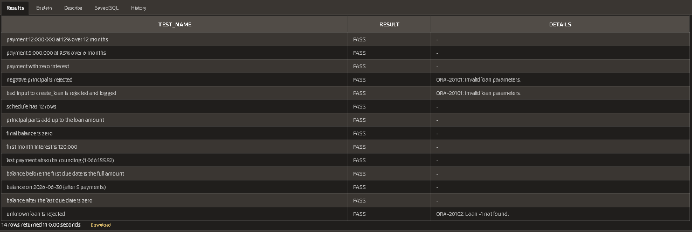
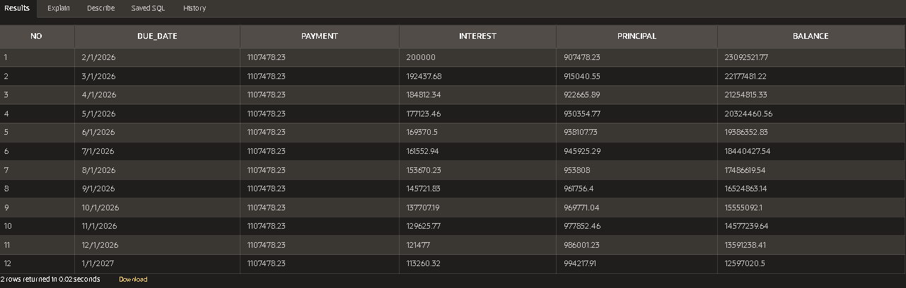

# Oracle Loan Package (PL/SQL)

A PL/SQL package that calculates loan payments, generates repayment
schedules, and reports outstanding balances, with input validation,
error logging, and an automated test script.

## Features
- Monthly payment calculation (including 0% interest)
- Full amortization schedule; the last installment absorbs rounding
- Outstanding balance on any date
- Custom error codes (-20101 bad input, -20102 loan not found)
- Errors logged through an autonomous transaction
- 14 automated checks recorded in a results table

## Files
| File | Purpose |
|---|---|
| `01_tables.sql` | Creates the tables |
| `02_loan_pkg_spec.sql` | Package specification (public interface) |
| `03_loan_pkg_body.sql` | Package body (implementation) |
| `04_tests.sql` | Automated checks; results go to `TEST_RESULTS` |
| `05_demo.sql` | Creates a sample loan and shows its schedule |

## How to run
Run the files in numeric order in any Oracle database, for example in
Oracle APEX under SQL Workshop > SQL Scripts. Then query the results:

```sql
select test_name, result, details from test_results order by run_at;
```

All 14 checks should show `PASS`.

## Tech
Oracle Database, PL/SQL, Oracle APEX SQL Workshop

## Data
All data is fictional sample data.

## Screenshots




